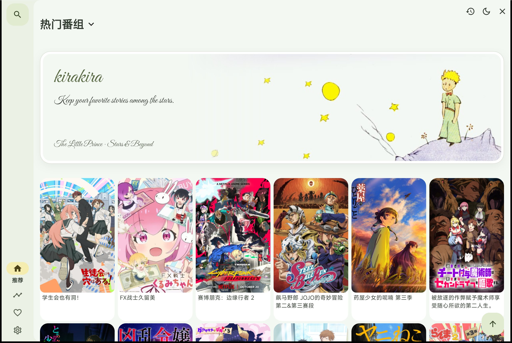

# キラキラ · kirakira

基于 [Predidit/Kazumi](https://github.com/Predidit/Kazumi) 的个人定制版本，使用 Flutter 开发。本仓库保留上游历史与 GPL-3.0 许可证；定制内容包括小王子主题、明暗模式、品牌图标，以及搜索、评论和更新通道修复。

当前定制版本为 **2.3.11**。本项目独立于 Kazumi 上游，也不是弹弹play官方客户端。



## 定制内容

- 小王子浅色插画与深色星空主题，首页卡片式横幅，英文花体标题与文案。
- 首页右上角切换明暗模式，并保存主题选择。
- 应用显示名称为「キラキラ」，首页品牌为 `kirakira`。
- Windows 与 Android 共用主题和界面代码；播放器选集条目单独显示集数，保留原标题。
- 缺少 Kazumi 镜像应用凭据时，搜索和评论使用 Bangumi 官方公开接口。
- 应用更新只检查本仓库的 GitHub Releases，支持 Windows EXE / ZIP 和 Android ARM64 APK；保留独立的播放源规则更新与兼容性校验。

更多改动见 [主题与构建说明](KIRAKIRA-THEME.md)、[更新通道说明](UPDATE-CHANNEL.md) 和 [评论、弹幕接口说明](COMMENTS-DANMAKU.md)。

## 弹幕接入说明

2.3.11 新增 [LogVar 自建多平台弹幕](DANMAKU-SERVICE.md)。配置 `DANMAKU_API_BASE_URL` 后，可连接自己的 HTTPS 服务，按番剧名、年份和集数匹配，再读取服务返回的真实 episodeId。服务选择直接平台来源时不依赖弹弹play应用审核。弹幕数据不随源码分发。

已通过应用请求代码实测自动匹配、完整28集列表和手动获取，《葬送的芙莉莲》第1集返回2869条弹幕。当前相关回归45项通过；结果不保证所有作品、来源和时间轴都可用。

没有配置自建服务时，保留 [弹弹play开放弹幕网络](https://doc.dandanplay.com/open/) 的授权接口兼容性：

目前使用的功能包括：

| 功能 | 官方请求路径 |
| --- | --- |
| 用 Bangumi 条目编号匹配番剧 | `GET /api/v2/bangumi/bgmtv/{id}` |
| 获取番剧分集列表 | `GET /api/v2/bangumi/{id}` |
| 手动按番剧名检索 | `GET /api/v2/search/episodes` |
| 读取分集弹幕并整合关联来源 | `GET /api/v2/comment/{episodeId}` |

实现可查看 [弹幕 API](lib/request/apis/danmaku_api.dart)、[签名请求客户端](lib/request/clients/danmaku_client.dart) 和 [播放器弹幕控制器](lib/pages/player/controller/player_danmaku_controller.dart)。当前客户端用于读取、匹配和展示弹幕，上述流程不发送弹幕。

**弹弹play独立应用接入尚未获批。** 此前验证返回 `403 / Invalid AppId`；自建服务接入不代表获得了弹弹play官方权限。

`AppId` / `AppSecret` 由维护者自行申请。真实凭据保存在源码目录外，通过构建参数注入；仓库仅包含空值示例，不包含 AppSecret、Android 发布私钥、用户账户 Token 或观看记录。请勿使用其他应用的凭据。

## 本地构建

工具链以 [pubspec.yaml](pubspec.yaml) 为准：Flutter **3.47.7**，并安装相应平台的编译工具。

```sh
flutter pub get
flutter analyze
flutter test
```

不配置弹幕服务也可以编译和查看界面；在线弹幕需要自己的可用服务配置，或者有效的弹弹play独立应用凭据。

```sh
flutter build windows --release
flutter build apk --release --split-per-abi --target-platform android-arm64
```

自建服务配置示例见 [DANMAKU-SERVICE.md](DANMAKU-SERVICE.md)；官方接口配置示例见 [tools/dandan-credentials.example.json](tools/dandan-credentials.example.json)。将自己的配置放在仓库目录外，再通过 `--dart-define-from-file=<本地私有配置路径>` 传入构建。不要把实际密钥填写到示例文件中。

Windows 安装包使用 [tools/package-windows.ps1](tools/package-windows.ps1) 和 Inno Setup 6。原生依赖 `ech_http` 在 Windows 上的编译说明见 [KIRAKIRA-THEME.md](KIRAKIRA-THEME.md)。

Android 定制包的应用 ID 为 `com.predidit.kazumi.kirakira`。发行构建须配置自己的签名文件；[tools/package-android.ps1](tools/package-android.ps1) 从仓库外读取签名配置。未配置私有签名的直接构建仅适合开发测试，不能覆盖使用其他密钥签名的安装包。

软件只检查 [本仓库 Releases](https://github.com/RUI-JACK/kirakira/releases) 的正式版本，并验证定制文件名、仓库下载地址及 GitHub 提供的 SHA256 摘要。设置 → 更新设置可开启或关闭启动检查；关于 → 检查更新可随时手动检查。旧设置中的开关选择会保留。

**推送源码不等于发布软件更新。** 发布新版本需要在 Releases 创建更高版本的标签（例如 `v2.3.11`），上传该版本的定制安装包。发布步骤、文件名和安卓签名要求见 [UPDATE-CHANNEL.md](UPDATE-CHANNEL.md)。仓库没有正式 Release 时，软件会提示等待发布，不会退回 Kazumi 原版通道。

仓库保留的上游 CI 工作流需要维护者自行配置凭据和签名服务；当前没有为本仓库配置自动发布。不要将原版 Kazumi 安装包作为本定制版更新。

## 验证范围

- Windows x64：已完成本机构建、安装和启动检查。
- Android ARM64：已在 Android 16 模拟器安装同一发布 APK，验证主题切换、搜索和作品吐槽显示。
- 评论接口：分集匹配和解析实测可读取《葬送的芙莉莲》第 1 集讨论；2026-10-22 的相关回归共 26 项通过。
- 自建弹幕：已通过公网 HTTPS 实测搜索、自动匹配、完整选集和实际弹幕解析；管理接口不向客户端开放。
- 实体手机、所有播放源、完整播放、下载及投屏未完成全面验证。
- iOS、macOS、Linux 保留上游代码及定制品牌配置，本机未验证发布构建。

## 反馈与隐私

本定制版问题请提交到 [本仓库 Issues](https://github.com/RUI-JACK/kirakira/issues)。反馈时请删除日志中的账户信息、密钥及带签名的播放地址。

联网功能会按配置请求 Bangumi、自建弹幕服务或弹弹play及用户所选的播放源。不要将自己的本地配置、缓存、观看记录或签名文件上传到公开仓库。

## 来源与许可

代码沿用上游 [GPL-3.0 许可证](LICENSE)，原作者与贡献者的署名保留。上游介绍归档在 [README.upstream.md](README.upstream.md)，其中原项目下载链接、赞助和签名信息属于上游项目。

主题插画和应用图标由本地使用者提供，第三方美术素材不因代码使用 GPL-3.0 而自动成为自由授权素材，其权利归相应权利人所有；本仓库不额外授予这些素材的商用许可。Great Vibes 字体许可见 [licenses/great_vibes/OFL.txt](licenses/great_vibes/OFL.txt)，MiSans 等资源沿用各自原有许可说明。

感谢 [Kazumi](https://github.com/Predidit/Kazumi)、[Bangumi](https://bangumi.tv/)、[LogVar danmu_api](https://github.com/huangxd-/danmu_api)、[弹弹play](https://www.dandanplay.com/)、media-kit、Anime4K 及其他上游依赖和贡献者。
